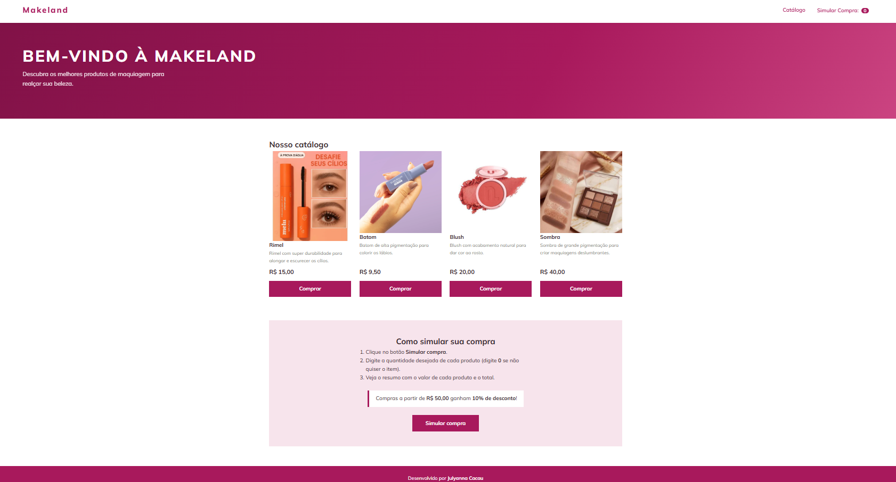

# 💄 Makeland — Loja de Maquiagem

- **Projeto:** Loja fictícia com simulação de compra em JavaScript
- **Aluna:** Julyanna Cacau
- **Trilha:** Desenvolvimento Mobile

## Apresentação da loja

A **Makeland** é uma loja fictícia de maquiagem. A página apresenta o catálogo de produtos e permite simular uma compra: o cliente informa quantas unidades quer de cada produto e recebe um resumo com o valor de cada item, o desconto (se tiver direito) e o total a pagar.

### Produtos e preços

| Produto | Descrição | Preço |
|---|---|---|
| Rimel | Rimel com super durabilidade para alongar e escurecer os cílios | R$ 15,00 |
| Batom | Batom de alta pigmentação para colorir os lábios | R$ 9,50 |
| Blush | Blush com acabamento natural para dar cor ao rosto | R$ 20,00 |
| Sombra | Sombra de grande pigmentação para criar maquiagens deslumbrantes | R$ 40,00 |

**Regra de desconto:** compras com subtotal a partir de **R$ 50,00** ganham **10% de desconto**.

## Tecnologias

- **HTML5** — estrutura da página (`index.html`)
- **CSS3** — menu, banner, cards em grid e painel lateral (`style.css`)
- **JavaScript** — simulação da compra com `prompt()`, `Number()` e `alert()`, e painel lateral com o resumo (`script.js`)
- **Google Fonts** — fonte Mulish

## Estrutura de arquivos

```
makeland/
├── index.html
├── style.css
├── script.js
├── README.md
└── assets/
    ├── rimel.png
    ├── batom.png
    ├── blush.png
    ├── sombra.jpg
    └── captura-loja.png
```

## Como executar

1. Baixe ou clone este repositório.
2. Abra o arquivo `index.html` em qualquer navegador (Chrome, Edge, Firefox).
3. Clique em **Simular compra** (no menu, nos botões **Comprar** ou na seção de instruções).
4. Responda as caixas do navegador (`prompt`) com a quantidade de cada produto (0 para não comprar).
5. Veja o resumo no `alert()` e, ao clicar em OK, no painel lateral. Para fechar o painel, clique no ✕ ou fora dele.

Não é preciso instalar nada.

## Como funciona o JavaScript

1. Os botões chamam a função `simularCompra()` pelo atributo `onclick`.
2. Para cada produto, a função `perguntarQuantidade()` usa `prompt()` para perguntar a quantidade e `Number()` para converter a resposta em número. Se o valor for inválido (texto, negativo ou decimal), a pergunta é repetida.
3. Se todas as quantidades forem 0, aparece a mensagem “Nenhum produto foi selecionado”.
4. Caso contrário, calcula-se `preço × quantidade` de cada item e o subtotal.
5. Se o subtotal for ≥ R$ 50,00, aplica 10% de desconto.
6. `alert()` mostra a quantidade e o valor de cada produto, o desconto e o total.
7. O mesmo resumo é colocado no painel lateral com `innerText`, e `abrirPainel()` adiciona a classe `aberto`, que faz o painel deslizar pela lateral da tela. `fecharPainel()` remove essa classe.

Os preços do `script.js` são os mesmos exibidos na página.

## Captura de tela



## Dificuldade encontrada e aprendizado

A principal dificuldade foi estilizar a página com o css. Eu consegui fazer a lógica correta e o html, mas não estava visualmente agradável. Então busquei modelos no figma pra usar como base e consegui fazer.

## Uso de Inteligência Artificial

Utilizei IA (Claude) como apoio para melhorar o design da página, peguei uma página de exemplo no Figma e pedi pra IA me ajudar a gerar o css. Adaptei grande parte do que foi gerado, incluindo o tema de maquiagem, o nome Makeland, os produtos, as descrições, os preços e as imagens. 